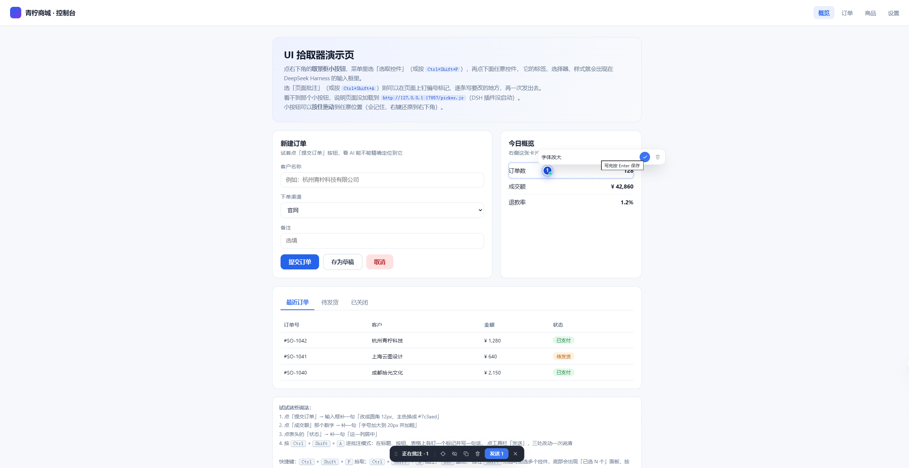
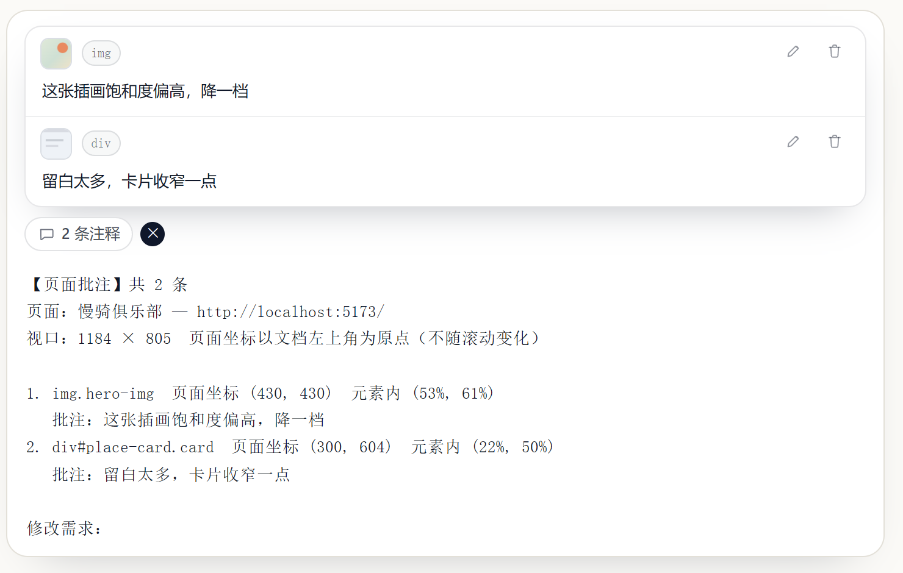

# dsh-ui-picker

[](https://dsh-plugin.org/plugins/ztlovelsw/dsh-ui-picker)

**Click the control on the page — or pin a comment right on it — and the AI knows what to change.**

[中文](README.md) · **English**

A UI-editing helper for people who don't live in DevTools: you don't need to know what a
"CSS selector", a "DOM node" or a "class name" is. Just click the place you want to change on
the page and the control's full technical identity is written straight into the
**DeepSeek Harness** composer; add one sentence like "make it a rounded blue button" and the
model can locate it precisely and edit it precisely.

These operations share one pipeline:

- **Element picker**: click one control → selector / XPath / component name / computed styles
  are all collected
- **Page annotations**: pin 1, 2, 3… numbered markers on the page, write one line per marker
  about what to change, and send them all at once
- **Comment review**: once sent, they become a 「N 条注释」 chip above the composer, where you
  step through the thumbnails, reword a line, and delete whatever you don't want

> Point at any UI control on your page — its selector, XPath, component name and computed
> styles are written straight into the **DeepSeek Harness** composer, so the model knows
> exactly which element you mean. Or pin numbered annotations anywhere on the page and send
> them as a single reviewed list.




---

## Why

When a non-frontend teammate describes a UI problem, the best they can say is "that blue
button" or "the card on the right"; what an AI needs to change a UI is `#submit-order`,
`//*[@id="submit-order"]`, `.btn.btn-primary`. That translation layer is now a single click.

When several places need changing, "click once, send once" turns into tab-switching back and
forth: hence **annotation mode** — like marking up a screenshot, pin numbered markers in
document order, write one comment per marker, and send them all at once. What the AI receives
is one list carrying coordinates, selectors and your own words.

## How it works

```
Your page under development              DSH Web GUI
┌──────────────────┐   POST /push      ┌───────────────────────────────┐
│ picker.js        │ ─────────────────▶│ bridge 127.0.0.1:17857        │
│ pick / annotate  │                   │        │ long-poll            │
└──────────────────┘                   │        ▼                      │
                                       │ client plugin → composer      │
                                       └───────────────────────────────┘
```

- **Host half** (`index.js`): a loopback-only mini HTTP service on `127.0.0.1:17857` that
  receives element descriptions, serves long-polling, and also serves `picker.js` as a static
  file.
- **Client half** (`client.js`): runs inside the DSH web client, polls the bridge and inserts
  the text at the caret through the composer facade (`captureInsertion` + `insertText`).
  It renders **no visible UI**.
- **Page half** (`picker.js`): runs in your own page — hover highlight, picking, annotations,
  description and formatting.

The bridge deliberately does *not* reuse DSH's own port or auth: an arbitrary page is
cross-origin and cannot hold DSH session cookies, so a dedicated loopback port is the simplest
reliable channel. It carries text only — no code execution, no file access.

## Features

- **One click, full identity**: tag / id / class / role / text / placeholder / aria-label,
  CSS selector, absolute XPath, ancestor chain, box size & position, key computed styles
- **Component awareness**: auto-detects React (fiber) and Vue 2/3 component names, plus class
  prefixes from libraries such as Element / Ant Design / Vant / MUI
- **Page annotations**: pin numbered markers anywhere on the page, write one comment each,
  `Ctrl+Enter` sends them all at once; markers are anchored in document coordinates, so
  scrolling and zooming never shift them, and they can be dragged to fine-tune
- **Annotation chip in the composer**: after sending, the batch becomes 「N 条注释」 — open it
  to go through each row's thumbnail / tag / original text, edit or delete them, and every
  change is written straight back into the annotation text block in the composer
- **Multi-select**: `Shift`-click to add, a bottom panel shows the selected count, `Enter`
  sends them as one numbered list
- **Draggable floating button**: glass-morphism viewfinder icon, position remembered per site,
  right-click to reset; dark-mode aware
- **Non-invasive**: no layout changes, no DOM pollution; nothing visible inside DSH either
- **Graceful fallback**: if the bridge is down, the text is copied to the clipboard with a
  notice
- **Shadow DOM & same-origin iframes**: pierces shadow roots and also hooks same-origin
  iframes

## Install

### 1. Add the plugin to DeepSeek Harness

```bash
git clone https://github.com/ztlovelsw/dsh-ui-picker.git
cd dsh-ui-picker
node install.mjs          # detects the profile, copies the plugin, writes the config
```

The script: copies the plugin files to `~/.dsh/plugins/dsh-ui-picker` → backs up the profile's
`package.json` → appends the dependency and `dsh.profile.bundles` → runs `pnpm install`.

Manual equivalent:

```jsonc
// ~/.dsh/profiles/<profile>/package.json
{
  "dependencies": {
    "dsh-ui-picker": "file:../../plugins/dsh-ui-picker"
  },
  "dsh": {
    "profile": {
      "bundles": ["@deepseek-ai/dsh-base", "...", "dsh-ui-picker"]
    }
  }
}
```

Then `cd ~/.dsh/profiles/<profile> && pnpm install`, and **restart DSH**.

> The plugin is zero-dependency. If `pnpm install` won't run, linking or copying the package
> directory into `profiles/<profile>/node_modules/dsh-ui-picker` works just as well
> (`mklink /J` on Windows).

### 2. Give the page a picker button (choose one)

**A. One line (recommended)**

```html
<script src="http://127.0.0.1:17857/picker.js"></script>
```

Put it before `</body>`. In a Vite / Next project, put it in the entry HTML.

**B. Userscript**: drag `dsh-ui-picker.user.js` into Tampermonkey.
It matches `localhost` / `127.0.0.1` / `file://` by default; to cover other domains, add
`// @match https://your-dev-domain/*` to the script header.

**C. Console**: paste the whole of `picker.js` into the console.

## Usage

1. A small glass-morphism button (viewfinder icon) appears at the bottom-right of the page
2. Click it → a mode menu opens: **element picker** (「选取控件」) / **page annotations**
   (「页面批注」) — shortcuts work too
3. Pick a mode to start; `Esc`, a second click on the button, or `×` exits

### Element picker

1. Hovering a control draws a blue outline
2. Click the target control → the text lands in the DSH composer
3. Append one sentence after the last line `修改需求：` and hit Enter

### Page annotations

Like marking up a screenshot: say everything that needs changing on one screen in one go.

1. `Ctrl + Shift + A` (or 「页面批注」 in the menu) enters annotation mode; the cursor becomes
   a crosshair
2. Click anywhere on the page → a numbered marker is pinned; write one comment in the bubble
   and press `Enter` to save
3. Keep clicking the next spot; clicking an existing marker lets you review / edit its
   comment, and dragging a marker fine-tunes its position
4. The toolbar's 「发送 N」 button or `Ctrl + Enter` → the numbered list is written into the
   DSH composer in one go
5. `Esc` exits annotation mode (markers stay on the page; come back in and keep editing)

Bottom toolbar:

| Element | Effect |
|---|---|
| Drag handle (six dots) | drags the toolbar |
| 正在批注 · N | current marker count |
| Target | show / hide the element outline of every marker (hovering a marker also outlines its element temporarily) |
| Eye | temporarily hide all markers so you can see the page as it really is |
| Copy | copies just the annotation text to the clipboard, without sending |
| Trash | clears all annotations |
| Send | sends the annotation list to the DSH composer |
| × | exits annotation mode (markers are kept) |

Markers are anchored to **document coordinates**, so scrolling and zooming never detach them
from the content; markers that leave the viewport are hidden automatically and reappear when
you scroll back.

### Proofreading comments in the DSH composer

After you hit 「发送」 on the page, that pile of comments is not a dead block of text — it turns
into a 「**N 条注释**」 chip above the composer:



- Click the chip → it unfolds row by row: a small element thumbnail, the tag name (`img` /
  `div`), your original comment
- The pencil rewords one row, the trash deletes one, the ✕ beside the chip clears them all
- Every change rewrites the 【页面批注】 block in the composer, and the count changes with it
- When you're happy, just hit Enter to send: the model receives the list you proofread

> The comment content sits in the composer as a text block (the model can only read composer
> content, not the card); the chip exists so you can proofread each row before sending. If DSH
> ever exposes a hidden-context API, this can move out of the composer.

### Multi-select

Hold `Shift` and click the first control to enter multi-select, then just click further
controls to add them; a bottom panel shows 「已选 N 个」 (N selected):

| Action | Effect |
|---|---|
| `Enter` / panel **发送** | sends everything as one merged message |
| `Esc` / panel **取消** | discards this multi-select |

### Button gestures

| Action | Effect |
|---|---|
| Drag | moves the button, remembered per site (`localStorage`), clamped back inside the viewport |
| Right-click | restores the default bottom-right position |
| Click | opens the mode menu; when a mode is already active, a click exits that mode |

`window.dshUiPicker.resetPosition()` resets it as well.

## What the output looks like

A single element:

```
【UI 控件】「提交订单」按钮
页面：青柠商城 · 控制台 — http://localhost:5173/checkout
定位：button#submit-order.btn.btn-primary · PrimaryButton（React）
文案「提交订单」，尺寸 112 × 44，位于 (56, 402)
样式：内边距 10px 20px｜圆角 10px｜背景 rgb(37, 99, 235)｜字色 rgb(255, 255, 255)｜字号 14px｜字重 600
父级：div.row ← section.card ← main（同级 3 个）
CSS：#submit-order　XPath：//*[@id="submit-order"]

修改需求：
```

Several elements:

```
【UI 控件】共 2 个
页面：青柠商城 · 控制台 — http://localhost:5173/checkout

01. 「提交订单」按钮　button#submit-order.btn.btn-primary
    文案「提交订单」，尺寸 112 × 44，位于 (56, 402)
    样式：内边距 10px 20px｜圆角 10px｜背景 rgb(37, 99, 235)｜字号 14px｜字重 600
    CSS：#submit-order

02. 「客户名称」输入框　input#customer
    尺寸 320 × 40，位于 (56, 300)
    样式：内边距 10px 12px｜圆角 10px｜边框 1px solid rgb(226, 232, 240)｜字号 14px
    CSS：#customer

修改需求：
```

Page annotations — three markers, one compact row each:

```
【页面批注】共 3 条
页面：青柠商城 · 结算页 — http://localhost:5173/checkout
视口：1440 × 900　页面坐标以文档左上角为原点（不随滚动变化）

1. h1#title.hero-title「确认订单」　页面坐标 (240, 168)　元素内 (18%, 62%)
   批注：标题太大，缩小 20%
2. div.hero-img　页面坐标 (640, 470)　元素内 (53%, 61%)
   批注：这张插画饱和度太高，降一档
3. div#summary.card「落日海岸」　页面坐标 (300, 604)　元素内 (22%, 50%)
   批注：这块留白太多，卡片收窄一点

修改需求：
```

An annotation that only has a pin and no comment is still listed (marked
「（未填写具体描述）」): the page coordinates plus the element selector are already enough for
the AI to locate it, your own words just help it understand the intent.

Only styling-relevant facts survive: `display: block`, `overflow: visible` and similar noise
are filtered out, and uninformative ancestors such as `body ← html` are dropped.

## Configuration

`cordis.patch.yml`:

```yaml
- insert:
    - id: dsh-ui-picker
      name: dsh-ui-picker
      config:
        enabled: true
        port: 17857     # change the port here, and in the page <script> URL too
```

## Shortcuts

| Key | Action |
|---|---|
| `Ctrl + Shift + P` | toggle pick mode |
| `Ctrl + Shift + A` | toggle annotation mode |
| `Shift + click` | add to selection (starts multi-select) |
| `Enter` | save an annotation comment / send a multi-select batch |
| `Ctrl + Enter` | send the annotation list |
| `Esc` | close the comment bubble first, then exit the current mode (annotation markers are kept) |

## Script API

You can call `window.dshUiPicker` directly from the page:

| Method | Effect |
|---|---|
| `.annotate()` / `.stopAnnotate()` | enter / leave annotation mode |
| `.annotations()` | read the current annotations (number, page coordinates, comment, selector) |
| `.formatAnnotations()` | read the whole block of text that would be sent |
| `.clearAnnotations()` | clear all annotations |
| `.start()` / `.stop()` | enter / leave pick mode |
| `.describe(el)` / `.format(info)` | collect / format a single element |
| `.push(text)` | push a piece of text straight into the DSH composer |
| `.resetPosition()` | reset the floating button position |

## Troubleshooting

| Symptom | Fix |
|---|---|
| No button at the bottom-right | the script didn't load: check whether `picker.js` returns 200 in Network, and whether `window.dshUiPicker` is an object in the console |
| It reports 「没连上 DSH」 (bridge unreachable) | the bridge isn't up: `curl http://127.0.0.1:17857/health`; make sure DSH was restarted |
| A notice appears but the composer stays empty | the composer facade changed: look for `[dsh-ui-picker]` warnings in the DSH console; the element info is printed there for manual copy |
| Clicking the page pins no marker | annotation mode isn't active (choose 「页面批注」 in the button menu, or `Ctrl + Shift + A`); if the page itself calls `stopPropagation` on `click`, call `window.dshUiPicker.annotate()` first and then click, or fall back to the element picker |
| Annotation markers drift away from the content | happens when scrolling happens inside an iframe, or an ancestor element has a `transform`; verify the coordinates with `window.dshUiPicker.annotations()` |
| Port already in use | `netstat -ano | findstr 17857`, then change the port or kill the process holding it |
| Button ends up off-screen | right-click the button to reset it, or `window.dshUiPicker.resetPosition()` |

## Development

```bash
npm test          # userscript in sync + bridge + client + duplicate-write regression
```

Individually:

```bash
node scripts/sync-userscript.mjs        # regenerate dsh-ui-picker.user.js from picker.js
node tests/bridge-test.mjs              # push / poll / long-poll / health / static picker.js
node tests/client-test.mjs              # drives the client plugin with fake react + ctx: insertText path + annotation block / chip
node tests/client-dup-test.mjs          # loads the module twice, asserts a single insertion
```

`picker.js` is the only implementation; the userscript is its mechanical copy — after editing
`picker.js` remember to run `npm run sync:user` (`npm test` checks that you didn't forget).

`tests/*.html` are visual browser cases:

| Case | Covers | How to run |
|---|---|---|
| `annotation-test.html` | the whole annotation flow: mode menu, pinning markers, comment bubble, outlines, hiding, text formatting, structured payload, keeping markers on `Esc`, deleting | open directly (send `picker.js` from the bridge on `17857`) |
| `annotation-preview.html` | what annotation mode looks like (pins three markers automatically; compare the styling against the design) | same as above |
| `client-chip.html` | the 「N 条注释」 chip above the composer: chip, card, thumbnails, edit / delete / clear, draft sync | `node tests/chip-bridge.mjs`, then open `http://127.0.0.1:17902/tests/client-chip.html` |
| `batch-test.html` / `fab-flow-test.html` | mode menu → picker / multi-select flow | open directly |
| `drag-*.html` / `clamp-test.html` | floating button dragging, clamping at the viewport edge, position reset | open directly |

`client-chip.html` renders the client plugin with real React from a CDN and stubs DSH's
composer facade inside the page (`setDraft` / `state.getSnapshot()`), so the whole path runs
without having to start DSH.

### Layout

```
dsh-ui-picker/
├── index.js               host: bridge HTTP service (push / poll / health / picker.js)
├── client.js              DSH web side: polling + composer insertion + annotation chip
├── picker.js              page side: picking / annotating, highlight, thumbnails & format
├── dsh-ui-picker.user.js  userscript build (picker.js + header, generated by scripts/)
├── cordis.patch.yml       plugin registration entry
├── install.mjs            installer
├── demo.html              demo page
├── preview-annotation.png annotation mode preview
├── preview-comments.png   annotation chip above the composer
├── preview-fab.png        floating button states preview
├── scripts/               sync-userscript.mjs: picker.js → userscript
└── tests/                 self-tests and visual cases
```

## Notes

- The bridge listens on `127.0.0.1` only, carries text only, executes no code and touches no
  files.
- If a page is served over `https://` on a public domain, the browser may block requests to a
  local port (Private Network Access); local `localhost` development is unaffected.
- With several DSH sessions open in multiple tabs, pick results go to the composer of the
  session that mounted last.

## License

[MIT](LICENSE)
