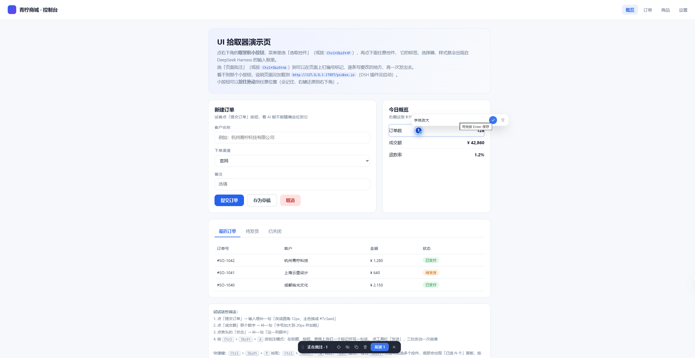
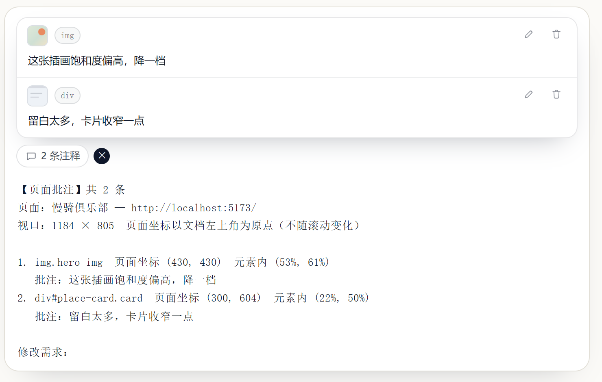

# dsh-ui-picker

[](https://dsh-plugin.org/plugins/ztlovelsw/dsh-ui-picker)

**点一下页面上的控件，或者直接在上面钉意见，AI 就知道你要改哪里。**

**中文** · [English](README.en.md)

给不熟悉前端术语的人用的 UI 修改助手：不用知道「CSS 选择器」「DOM 节点」「class 名」，
只要在页面上点一下要改的地方，控件的全部技术细节就会自动写进 **DeepSeek Harness** 的输入框，
再补一句「改成圆角蓝色」，AI 就能精准定位、精准修改。

两种操作用同一根管道：

- **选取控件**：点一个控件 → 选择器 / XPath / 组件名 / 计算样式全部采集
- **页面批注**：在页面上钉 1、2、3… 编号标记，每条写一句要改什么，一次性发出去
- **注释校对**：发过去之后变成输入框上方的「N 条注释」，逐条看缩略图、改文字、删掉不要的

> Point at any UI control on your page — its selector, XPath, component name and computed
> styles are written straight into the **DeepSeek Harness** composer, so the model knows
> exactly which element you mean. Or pin numbered annotations anywhere on the page and send
> them as a single reviewed list.




---

## 为什么需要它

非前端同学描述界面问题时，只能说出「那个蓝色的按钮」「右边那个卡片」；
而 AI 改 UI 需要的是 `#submit-order`、`//*[@id="submit-order"]`、`.btn.btn-primary`。
中间这层翻译，现在由一次点击完成。

要改的地方有好几处时，「点一下发一句」就变成了来回切换：
所以还有**批注模式**——像截图标注一样，在页面上按顺序钉编号标记、每条写一句评论，
最后一次性发出去，AI 拿到的是一份带坐标、带选择器、带你原话的清单。

## 工作方式

```
你正在开发的页面                        DSH Web GUI
┌──────────────────┐   POST /push    ┌──────────────────────────────┐
│ picker.js        │ ───────────────▶│ 桥接服务 127.0.0.1:17857      │
│ 点选控件 → 采集   │                 │        │ 长轮询              │
└──────────────────┘                 │        ▼                     │
                                     │ 客户端插件 → 写入输入框        │
                                     └──────────────────────────────┘
```

- **宿主侧**（`index.js`）：在 `127.0.0.1:17857` 起一个只监听本机的迷你 HTTP 服务，
  接收控件描述、提供长轮询，同时把 `picker.js` 当静态文件发出去。
- **客户端侧**（`client.js`）：DSH 网页里运行，轮询桥接服务，通过输入框 facade
  （`captureInsertion` + `insertText`）把文本插到光标处。**不渲染任何可见 UI**。
- **页面侧**（`picker.js`）：在你自己的页面里运行，负责悬停高亮、点选、采集信息。

桥接服务刻意不复用 DSH 自己的端口和鉴权：任意网页（不同源）拿不到 DSH 的会话 cookie，
独立回环端口最简单可靠。它只传文本，不执行代码、不读写文件。

## 特性

- **一次点击拿到全部定位信息**：标签 / id / class / role / 文案 / placeholder / aria-label、
  CSS 选择器、绝对 XPath、父级链、尺寸位置、关键计算样式
- **组件识别**：自动探测 React（fiber）、Vue 2/3 组件名，以及 Element / Ant Design / Vant / MUI 等库的类名
- **页面批注**：在页面任意位置钉编号标记，每条写一句评论，`Ctrl+Enter` 一次性发送；
  标记按文档坐标锚定，滚动、缩放都不会跑偏，可拖动微调
- **输入框里的注释胶囊**：批注发过去之后变成「N 条注释」，点开逐条看缩略图 / 标签 / 原文，
  能改能删，改动实时回写到输入框里的批注文本块
- **多选**：`Shift` 加选，底部面板显示已选数量，`Enter` 一次性发送成编号清单
- **可拖动的悬浮按钮**：玻璃拟态取景框图标，位置按站点记忆，右键还原；支持深色模式
- **零侵入**：不改变页面布局、不污染 DOM 结构；DSH 侧也没有任何可见 UI
- **兜底**：桥接没起来时自动复制到剪贴板，并给出提示
- **Shadow DOM / 同源 iframe**：能穿透 shadow root，也能钩住同源 iframe

## 安装

### 1. 装进 DeepSeek Harness

```bash
git clone https://github.com/ztlovelsw/dsh-ui-picker.git
cd dsh-ui-picker
node install.mjs          # 自动探测 profile，复制插件并写入配置
```

脚本会：复制插件文件到 `~/.dsh/plugins/dsh-ui-picker` → 备份 profile 的 `package.json`
→ 追加依赖与 `dsh.profile.bundles` → 执行 `pnpm install`。

不想用脚本就手动来：

```jsonc
// ~/.dsh/profiles/<profile>/package.json
{
  "dependencies": {
    "dsh-ui-picker": "file:../../plugins/dsh-ui-picker"
  },
  "dsh": {
    "profile": {
      "bundles": ["@deepseek-ai/dsh-base", "...", "dsh-ui-picker"]
    }
  }
}
```

然后 `cd ~/.dsh/profiles/<profile> && pnpm install`，**重启 DSH**。

> 插件是零依赖的；`pnpm install` 起不来时，直接把包目录链接/复制到
> `profiles/<profile>/node_modules/dsh-ui-picker` 也能跑（Windows 可用目录联接 `mklink /J`）。

### 2. 让页面长出拾取按钮（三选一）

**A. 加一行（推荐）**

```html
<script src="http://127.0.0.1:17857/picker.js"></script>
```

放在 `</body>` 前。Vite / Next 项目放进入口 HTML 即可。

**B. 油猴脚本**：把 `dsh-ui-picker.user.js` 拖进 Tampermonkey。
默认匹配 `localhost` / `127.0.0.1` / `file://`；要覆盖其它域名，在脚本头加
`// @match https://your-dev-domain/*`。

**C. 控制台临时粘贴** `picker.js` 全文。

## 使用

1. 页面右下角出现一个玻璃质感的小按钮（取景框图标）
2. 单击它 → 弹出模式菜单：**选取控件** / **页面批注**（也可以直接用快捷键进入）
3. 选一种模式开始；`Esc`、再点一次按钮或用 `×` 退出

### 选取控件

1. 鼠标划过控件会蓝色描边
2. 点一下目标控件 → 文本出现在 DSH 输入框
3. 在最后一行「修改需求：」后面补一句话，回车

### 页面批注

像截图标注那样，把一屏里所有要改的地方一次说完：

1. `Ctrl + Shift + A`（或菜单里的「页面批注」）进入批注模式，光标变成十字
2. 在页面上点一下 → 钉一个编号标记，气泡里写一句评论，`Enter` 保存
3. 继续点下一处；点已有标记可以回看 / 改评论，拖动标记可以微调位置
4. 工具栏「发送 N」或 `Ctrl + Enter` → 编号清单一次性写进 DSH 输入框
5. `Esc` 退出批注模式（标记会留在页面上，再进来接着改）

底部工具栏：

| 元素 | 作用 |
|---|---|
| 拖动条（六个点） | 拖动工具栏位置 |
| 正在批注 · N | 当前标记数量 |
| 准星 | 显示 / 收起所有标记对应的元素轮廓（鼠标划过标记时也会临时描出它对应的元素） |
| 眼睛 | 临时隐藏所有标记，看清页面原貌 |
| 复制 | 只把批注文本复制到剪贴板，不发送 |
| 垃圾桶 | 清空全部批注 |
| 发送 | 把批注清单发送到 DSH 输入框 |
| × | 退出批注模式（标记保留） |

标记锚在**文档坐标**上，滚动、缩放都不会跟内容脱开；跑出可视区的标记自动隐藏，滚回来就出现。

### 在 DSH 输入框里校对注释

在页面上点「发送」之后，这堆注释不是一段死文本，而是变成输入框上方的「**N 条注释**」胶囊：



- 点胶囊 → 逐条展开：元素小缩略图、标签名（`img` / `div`）、你的注释原文
- 铅笔改一句、垃圾桶删一条、胶囊旁的 ✕ 全部清空
- 每次改动都会同步改写输入框里的【页面批注】块，条数也跟着变
- 改完直接回车发送，模型拿到的就是你校对后的清单

> 注释内容以文本块的形式放在输入框里（模型只读得到输入框内容，读不到卡片），
> 胶囊的作用是让你在发送前逐条校对。DSH 一旦提供隐藏上下文接口，这块可以改到输入框之外。

### 多选

按住 `Shift` 点第一个控件进入多选，之后直接点其它控件继续加选；底部出现「已选 N 个」面板：

| 操作 | 效果 |
|---|---|
| `Enter` / 面板「发送」 | 合并成一条消息发出 |
| `Esc` / 面板「取消」 | 丢弃本次多选 |

### 按钮手势

| 操作 | 效果 |
|---|---|
| 拖动 | 移动位置，按站点记住（`localStorage`），越界自动夹回 |
| 右键 | 还原到右下角默认位置 |
| 单击 | 打开模式菜单；已经在某个模式里时，单击即退出该模式 |

也可以 `window.dshUiPicker.resetPosition()` 复位。

## 输出长什么样

单个控件：

```
【UI 控件】「提交订单」按钮
页面：青柠商城 · 控制台 — http://localhost:5173/checkout
定位：button#submit-order.btn.btn-primary · PrimaryButton（React）
文案「提交订单」，尺寸 112 × 44，位于 (56, 402)
样式：内边距 10px 20px｜圆角 10px｜背景 rgb(37, 99, 235)｜字色 rgb(255, 255, 255)｜字号 14px｜字重 600
父级：div.row ← section.card ← main（同级 3 个）
CSS：#submit-order　XPath：//*[@id="submit-order"]

修改需求：
```

多个控件：

```
【UI 控件】共 2 个
页面：青柠商城 · 控制台 — http://localhost:5173/checkout

01. 「提交订单」按钮　button#submit-order.btn.btn-primary
    文案「提交订单」，尺寸 112 × 44，位于 (56, 402)
    样式：内边距 10px 20px｜圆角 10px｜背景 rgb(37, 99, 235)｜字号 14px｜字重 600
    CSS：#submit-order

02. 「客户名称」输入框　input#customer
    尺寸 320 × 40，位于 (56, 300)
    样式：内边距 10px 12px｜圆角 10px｜边框 1px solid rgb(226, 232, 240)｜字号 14px
    CSS：#customer

修改需求：
```

页面批注：

```
【页面批注】共 3 条
页面：青柠商城 · 结算页 — http://localhost:5173/checkout
视口：1440 × 900　页面坐标以文档左上角为原点（不随滚动变化）

1. h1#title.hero-title「确认订单」　页面坐标 (240, 168)　元素内 (18%, 62%)
   批注：标题太大，缩小 20%
2. div.hero-img　页面坐标 (640, 470)　元素内 (53%, 61%)
   批注：这张插画饱和度太高，降一档
3. div#summary.card「落日海岸」　页面坐标 (300, 604)　元素内 (22%, 50%)
   批注：这块留白太多，卡片收窄一点

修改需求：
```

即使某条批注只钉了点、没写评论也会照样列出（标成「（未填写具体描述）」）：
页面坐标 + 元素选择器已经够 AI 定位，你的原话只是让它更懂意图。

只保留对改样式有用的信息：`display: block`、`overflow: visible` 这类噪音会被过滤，
`body ← html` 这种无信息量的父级也会去掉。

## 配置

`cordis.patch.yml`：

```yaml
- insert:
    - id: dsh-ui-picker
      name: dsh-ui-picker
      config:
        enabled: true
        port: 17857     # 改端口后，页面里的 script 地址也要跟着改
```

## 快捷键

| 键 | 作用 |
|---|---|
| `Ctrl + Shift + P` | 开关拾取模式 |
| `Ctrl + Shift + A` | 开关批注模式 |
| `Shift + 点击` | 加选（进入多选） |
| `Enter` | 保存批注评论 / 发送多选结果 |
| `Ctrl + Enter` | 发送批注清单 |
| `Esc` | 先关评论气泡，再退出当前模式（批注标记保留） |

## 脚本 API

页面里可以直接调 `window.dshUiPicker`：

| 方法 | 作用 |
|---|---|
| `.annotate()` / `.stopAnnotate()` | 进入 / 退出批注模式 |
| `.annotations()` | 读出当前批注（编号、页面坐标、评论、选择器） |
| `.formatAnnotations()` | 读出将要发送的整段文本 |
| `.clearAnnotations()` | 清空批注 |
| `.start()` / `.stop()` | 进入 / 退出拾取模式 |
| `.describe(el)` / `.format(info)` | 采集 / 格式化单个控件 |
| `.push(text)` | 直接把一段文本推进 DSH 输入框 |
| `.resetPosition()` | 还原悬浮按钮位置 |

## 排错

| 现象 | 处理 |
|---|---|
| 页面右下角没有按钮 | 脚本没加载：看 Network 里 `picker.js` 是否 200；控制台执行 `window.dshUiPicker` 是否为对象 |
| 点了提示「没连上 DSH」 | 桥接没起来：`curl http://127.0.0.1:17857/health`；确认重启过 DSH |
| 有提示但输入框没字 | 输入框 facade 变了：看 DSH 控制台有没有 `[dsh-ui-picker]` 警告；此时控件信息会打印在控制台可手动复制 |
| 点页面没钉出标记 | 批注模式没进（按钮菜单里选「页面批注」，或 `Ctrl + Shift + A`）；如果页面自己 `stopPropagation` 了 `click`，用 `window.dshUiPicker.annotate()` 后再点，或改用选取控件 |
| 批注标记跟内容错位 | 页面在 iframe 内部滚动、或祖先元素有 `transform` 时会出现；用 `window.dshUiPicker.annotations()` 核对坐标 |
| 端口被占用 | `netstat -ano | findstr 17857`，改端口或结束占用进程 |
| 按钮位置跑到屏幕外 | 右键按钮还原，或 `window.dshUiPicker.resetPosition()` |

## 开发

```bash
npm test          # 油猴脚本是否同步 + 桥接 + 客户端 + 重复写入回归
```

单独跑：

```bash
node scripts/sync-userscript.mjs        # 由 picker.js 重新生成 dsh-ui-picker.user.js
node tests/bridge-test.mjs              # push / poll / 长轮询 / health / picker.js 静态服务
node tests/client-test.mjs              # 假 react + 假 ctx 驱动客户端插件：insertText 链路 + 注释块 / 胶囊
node tests/client-dup-test.mjs          # 同一页面加载两份模块，断言只写入一次
```

`picker.js` 是唯一实现，油猴版是它的机械副本——改完 `picker.js` 记得跑
`npm run sync:user`（`npm test` 会检查有没有忘记）。

`tests/*.html` 是浏览器端的可视化用例：

| 用例 | 覆盖 | 怎么跑 |
|---|---|---|
| `annotation-test.html` | 批注全流程：模式菜单、钉标记、评论气泡、轮廓、隐藏、文本格式、结构化 payload、Esc 保留、删除 | 直接打开（用 `17857` 上的桥接发 `picker.js`） |
| `annotation-preview.html` | 批注模式的样子（自动钉三条，对照设计看样式） | 同上 |
| `client-chip.html` | 输入框上方的「N 条注释」：胶囊、卡片、缩略图、编辑 / 删除 / 清空、草稿同步 | `node tests/chip-bridge.mjs`，再开 `http://127.0.0.1:17902/tests/client-chip.html` |
| `batch-test.html` / `fab-flow-test.html` | 模式菜单 → 拾取 / 多选链路 | 直接打开 |
| `drag-*.html` / `clamp-test.html` | 悬浮按钮拖拽、越界夹回、位置还原 | 直接打开 |

`client-chip.html` 用 CDN 上的真 React 渲染客户端插件，并在页面里模拟 DSH 的输入框 facade
（`setDraft` / `state.getSnapshot()`），所以能跑完整链路又不需要启动 DSH。

### 目录

```
dsh-ui-picker/
├── index.js              宿主：桥接 HTTP 服务（push / poll / health / picker.js）
├── client.js             DSH 网页侧：轮询 + 写入输入框 + 注释胶囊（卡片/编辑/删除）
├── picker.js             页面侧：拾取 / 批注、高亮、信息采集、缩略图与格式化
├── dsh-ui-picker.user.js 油猴版本（picker.js + 脚本头，由 scripts/ 生成）
├── cordis.patch.yml      插件注册条目
├── install.mjs           安装脚本
├── demo.html             演示页
├── preview-annotation.png 批注模式预览
├── preview-comments.png  输入框上方的注释胶囊预览
├── preview-fab.png       按钮三态预览
├── scripts/              sync-userscript.mjs：picker.js → 油猴脚本
└── tests/                自测脚本与可视化用例
```

## 说明

- 桥接只监听 `127.0.0.1`，只传文本，不执行代码、不读写文件。
- 页面若是 `https://` 且部署在公网域名，浏览器可能拦截到本机端口的请求
  （Private Network Access）；本地 `localhost` 开发不受影响。
- 多标签页同时打开多个 DSH 会话时，拾取结果写入最后挂载的那个会话输入框。

## License

[MIT](LICENSE)
